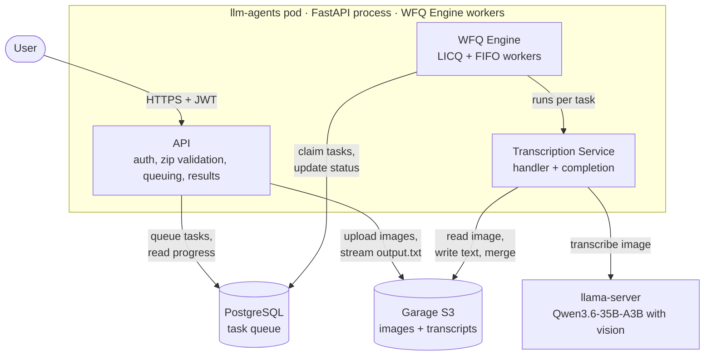
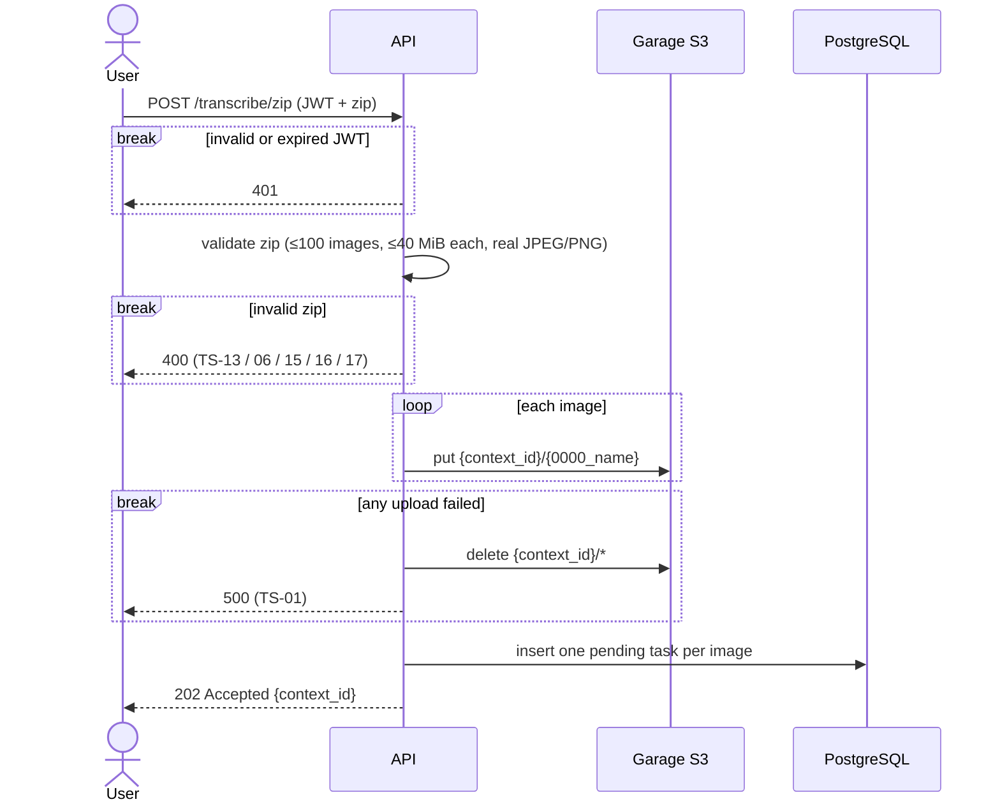
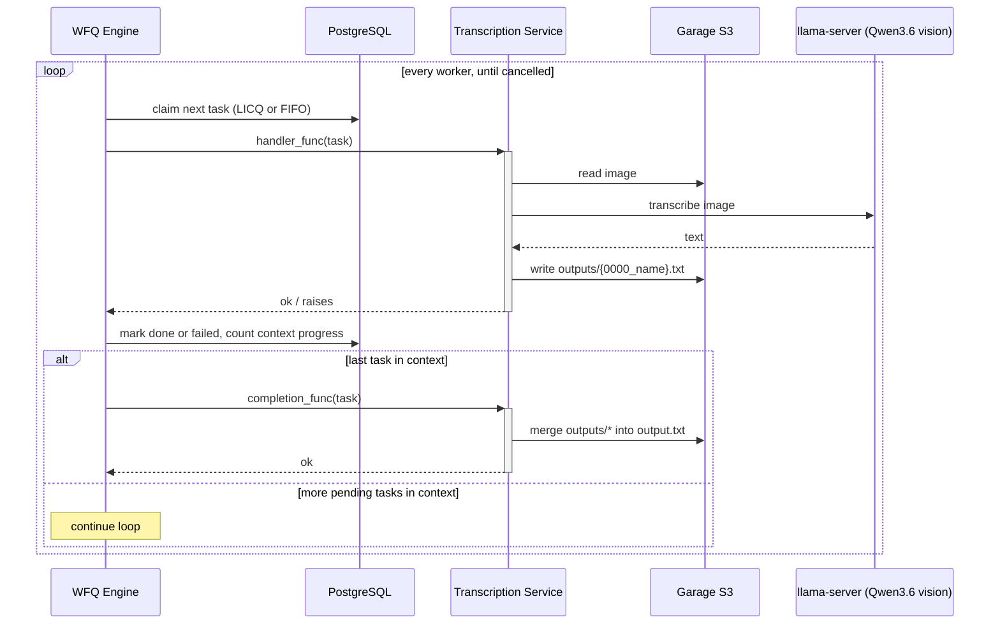
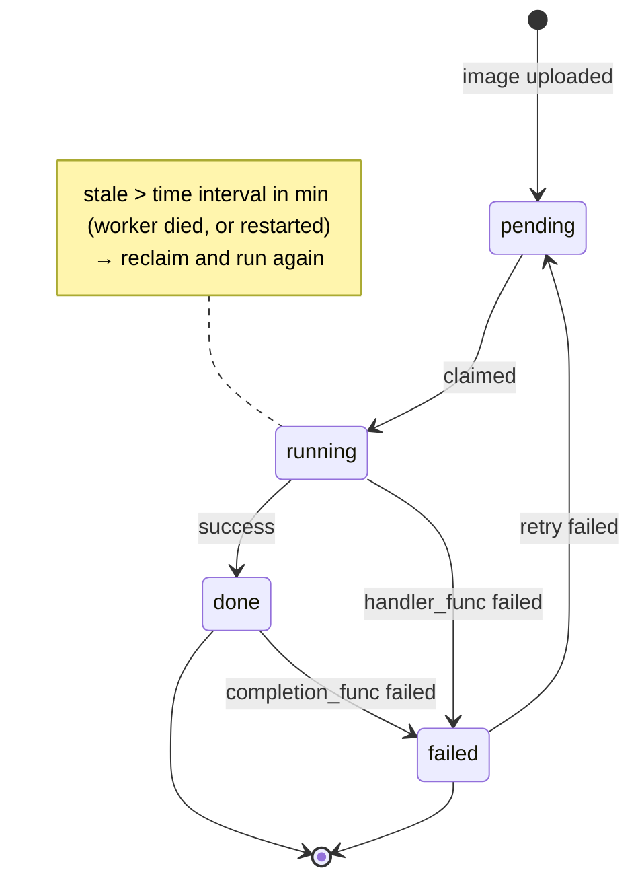
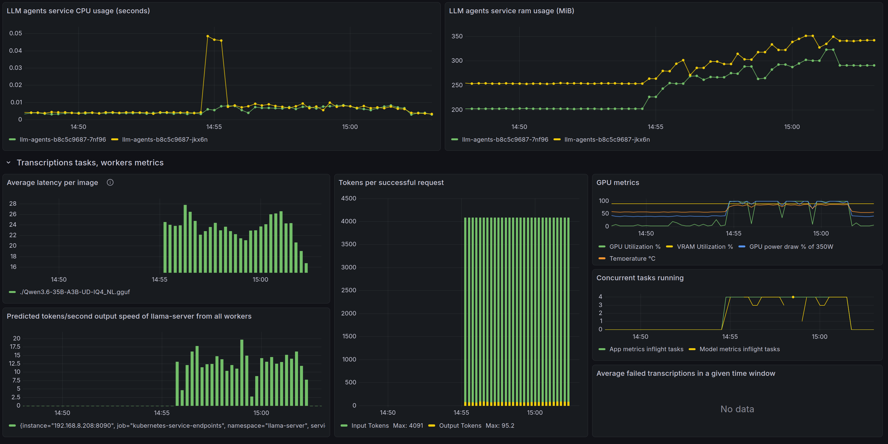

# LLM agents service

This service is for defining llm agents for working on concisely
divided tasks using pydantic AI and plain python code. It is designed
to deploy and run inside a kubernetes cluster similar to:
([homelab setup](https://github.com/milanpanic2/homelab-main)).

## Transcriptions agent

Transcribes handwritten or printed pages into text with a self-hosted vision LLM.
Upload a zip of photos, get back one text file — 70 pages in ~8 minutes instead of
weeks by hand. Built with FastAPI, pydantic-ai, a fair Postgres-backed task queue,
Garage S3 and llama-server, preferably running on Kubernetes.

**Highlights**
- [Fair task queue on PostgreSQL](#why-postgresql): `SKIP LOCKED` + per-user [longest idle scheduling](#licq-and-fifo-workers), no extra broker
- [Exactly-once completion](#exactly-once-completion) across concurrent workers via advisory locks
- [Measured](#performance): 70 handwritten pages in ~8 min on one GPU, app at ~0.005 CPU / ~300 MiB

### C2 Diagram

The WFQ Engine is generic: it's constructed on app startup (or
as can be run as separate deployment), receives the transcription logic as
callback arguments (handler_func, completion_func),
and sql claim query as parameter so it can run wider range
of tasks in wide ordering range. See src/WFQEngine/README.md
for WFQ Engine construction.

### Main workflows
#### Upload

#### Processing

### State diagram of a task

### Design decisions

#### PostgreSQL as tasks queue
##### Why PostgreSQL

1. `FOR UPDATE SKIP LOCKED` lets many workers claim tasks concurrently without collisions or waiting.
2. The claim order is just an SQL `ORDER BY`, so fairness strategies (LICQ, FIFO, priority tiers) are one query each.
3. Tasks, progress and ownership live in the same transactional store; no second system to keep in sync.

##### Why not Redis:
1. Gives the ability to easily add and remove running tasks
instead of changing the status, BUT additionally needs to keep track of
pending tasks in PostgreSQL, which adds another source of truth
that need to be in-sync with Redis
2. With TaskIQ - gives the ability to run tasks
in separate workers, BUT its main use case is retryable
long-running tasks and waits for result, and the ordering is FIFO.

##### Why not RabbitMQ with TaskIQ:
1. Gives the ability to run tasks in separate workers,
BUT its main use case is retryable long-running tasks and waits
for result, and the ordering is FIFO.

##### Why not Kafka
1. Consumer groups give concurrent consumers, BUT delivery to external side effects
   (LLM call, S3 write) is at-least-once, so it needs an idempotent consumer: a
   deduplication table of processed message ids, checked on every consume.
   This queue is at-least-once too, but the task's
   `status` already is that deduplication record, updated in the same transaction as
   the claim, and handlers are idempotent (they overwrite the same output object).
2. A partition is an ordered log consumed by offset, so "take the task of the user who
   waited longest" (LICQ) can't be expressed. Here every claim strategy is one SQL
   `ORDER BY`.

#### Why WFQ Engine with LICQ and FIFO workers

For agentic LLM work throughput and reliability are
the main concerns, instead of request latency. Constrained llm resources
makes it so that only few concurrent inferences can be run, and in
those cases, basic FIFO ordering does not cut it. e.g. users
with small number of images are waiting for a user with big number
of images to finish in order for their work to start.

WFQ Engine provides a type that when given 3 params: handler
function, completion function and task claim query, makes it easy
to do any kind of task processing, and in any order desired.

##### LICQ and FIFO workers

The 2 different kinds of SQL query claims used are based on
LICQ (longest idle context queuing), and FIFO (first in, first out).

FIFO gives the system an ability to consistently work on oldest
submitted tasks, so that no user waits too long, while LICQ makes
it possible so that small contexts don't have to wait
behind big contexts before starting. It selects a task from
the context whose most recent started_at is the oldest, meaning
the context that was idle the longest compared to other contexts,
or is NULL, meaning never worked on this context's tasks.

##### Exactly-once completion

When two workers finish the last two tasks of a context at the same moment, each one
updates its task and counts the context's progress. Without coordination, both can see
"all tasks finished" and run `completion_func` twice — or neither sees it (each counts
before the other commits) and the merge never runs.

The fix is mutual exclusion per context: every worker takes a PostgreSQL advisory lock
on the `context_id` before updating and counting, all in one transaction:

`SELECT pg_advisory_xact_lock(hashtext(:context_id))`

Workers finishing tasks of the same context take turns, so exactly one of them sees the
final count and calls `completion_func`. (This relies on READ COMMITTED: the count runs
after the lock is acquired, so it sees every update committed while waiting.)

##### Stale tasks reclaim

Because the workers can be started and restarted whenever, a worker
can be interrupted while working on a 'running' task. So a reclaim
mechanism is needed that checks for 'running' tasks that are
in 'running' state for longer than a certain amount of time (reclaim time).
If such a task is found, the handler_func is called for it, and on
finishing, the worker loop is resumed.
`Note: the reclaim time should always be longer than 1 task
takes to complete with retry, so no currently 'running' tasks are reclaimed`

### Performance

The image below shows the metrics of the transcriptions agent
while running. The submitted zip file is 212 MiB,
has 70 jpeg images taken with an iPhone 17 around 3-4 MiB each.
It is done in ~ 8 minutes, each image taking 20-30 seconds depending
on the image. 4 concurrent workers, 2 FIFO and 2 LICQ are running.

- the GPU is saturated, and the bottleneck is prefill of ~4k image tokens per page, not the app
- the app itself uses about 0.005 CPU cores and ~300 MiB per pod
- about 9 images/min overall throughput

### API

| endpoint                                                            |                 purpose                  |                                     error codes |
|:--------------------------------------------------------------------|:----------------------------------------:|------------------------------------------------:|
| POST: /llm-agents/v1/transcription-agent/transcribe/zip             | submit zip file for image transcriptions | TS-06, TS-13, TS-14, TS-15, TS-16, TS-17, TS-18 |
| GET: /llm-agents/v1/transcription-agent/{context_id}                |   get progress of the submitted images   |                                           TS-04 |
| GET: /llm-agents/v1/transcription-agent/{context_id}/download       |    download transcribed file if ready    |                                    TS-07, TS-08 |
| PATCH: /llm-agents/v1/transcription-agent/{context_id}/retry_failed | retry failed for context if failed tasks |                                           TS-05 |

### Future work
rate limiting / quotas, Stripe, presigned garage downloads,
alembic migrations, a retention job, image-downscaling,
tests, completion_func failure to not fail all tasks.
