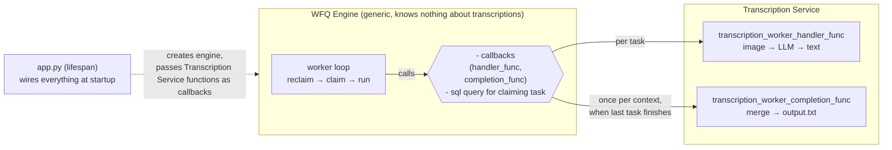

## WFQ Engine

A reusable and concurrency safe library that uses PostgreSQL for
queuing and running tasks that can be retrieved with custom ordering using
[wfq_queries.py](./wfq_queries.py). Custom SQL query also makes it
easily extensible, because a `SELECT` query with `ORDER BY` are the
main mechanisms. [app.py](../app.py) shows an example of how
multiple concurrent workers can be started.
It uses `SELECT ... SKIP LOCKED` feature so concurrent workers don't
wait on each other, they just execute tasks; and `pg_advisory_lock`
so no double completions happen for the concurrent workers. The main
execution also adds a reclaim for stale tasks, so network failures and
unexpected worker restarts are also handled cleanly.

More info in [ the repository's main README.md file](../../README.md).

### WFQ engine calling transcription service functions

Example flow available in the codebase:
